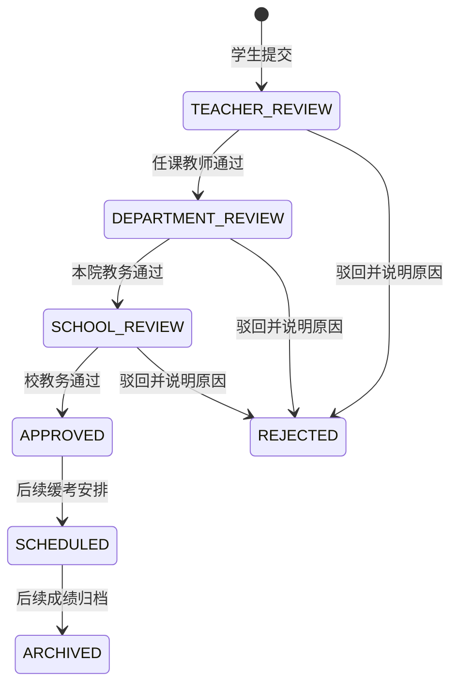

# 需求规格说明书

版本：0.2；日期：2026-11-27；状态：用户已确认FastAPI与演示规则可先推进，M1实现待验收，正式校规待补充。

## 1. 背景、依据和边界

依据根目录《基于BS的高校学生课程缓考与重修管理系统的设计与实现-高阳.docx》的研究内容，细化为可以开发、测试与验收的需求。原文是研究纲要，并未提供学校具体管理办法；下列期限、资格和阈值均为演示假设，不能当作学校规定。附件中的行文建议作为资料，不作为本次操作指令。

目标：将申请、材料、审核、安排、选课、成绩、通知串联，保证同一申请的节点、权限和处理记录一致，为论文提供可复现证据。系统面向电脑浏览器，保留小屏布局。当前不接真实学籍系统、统一认证、支付或微信；“归档到学籍”先实现本系统内归档及对接接口规划。

智能能力采用可解释规则和统计，不把普通条件判断包装为机器学习，不依赖外部大模型。

## 2. 角色和数据范围

| 角色 | 数据范围 | 操作 |
| --- | --- | --- |
| STUDENT 学生 | 本人课程、成绩、申请、通知 | 提交申请和材料，查询进度，后续选课 |
| TEACHER 教师 | 本人承担课程的申请及班级 | 缓考初审，后续重修名单与成绩录入 |
| DEPARTMENT_ADMIN 院系教务 | 本院学生申请 | 缓考二审、重修初审、院系统计和名单 |
| SCHOOL_ADMIN 校教务 | 全校 | 终审，后续安排、开班、基础数据和规则配置 |

后端逐请求校验数据范围。前端隐藏入口只改善体验，不承担权限控制。学校管理员不能跳过教师和院系的必经审核节点。教师不能审核未分配给自己的课程，院系不能处理其他院系学生。

## 3. 功能与验收条件

| 编号 | 需求 | 验收条件 | 阶段 |
| --- | --- | --- | --- |
| AUTH-01 | 登录、退出、查询本人身份 | 错误密码统一提示；退出后无法读取受保护接口；密码采用 BCrypt 存储 | M1 |
| AUTH-02 | 角色与数据隔离 | 越角色、跨学生、跨教师、跨院系访问均被拒绝 | M1 |
| COURSE-01 | 个人课程与成绩 | 学生只能看到自己的选课，展示课程、学期、教师、考试时间和成绩状态 | M1 |
| DEF-01 | 缓考申请与材料 | 选择本人未出分且未开考课程，填写10–1000字理由，上传PDF/JPEG/PNG证明；返回申请编号 | M1 |
| DEF-02 | 前置校验 | 拦截非本人课程、已出分、过期、材料缺失、重复有效申请，提示原因 | M1 |
| FLOW-01 | 串行三级审核 | 通过后仅下一角色可处理；驳回须填原因并终止；重复处理返回冲突 | M1 |
| FLOW-02 | 审核轨迹 | 记录节点、审核人、意见、时间；申请人能查完整轨迹 | M1 |
| NOTICE-01 | 站内通知 | 提交与审核产生通知，接收人隔离，可标记已读 | M1 |
| RET-01 | 重修申请 | 演示资格：已有不及格成绩；同课程同学期不得重复有效申请 | M2 |
| RET-02 | 院系、校教务审核 | 不含教师前置审核；通过后进入待选课 | M2 |
| CLASS-01 | 重修开班与选课 | 课程、教师、容量、时间段完整；不超容量；同班不重复选 | M2 |
| CONFLICT-01 | 冲突检测 | 周次、星期、节次均相交则冲突；返回冲突班级与时间依据 | M2 |
| EXAM-01 | 缓考安排 | 仅审批通过者可安排；通知学生；校验教师、学生、教室时间冲突 | M3 |
| GRADE-01 | 成绩录入与归档 | 授课教师录入0–100分；教务确认后归档；修改留历史 | M3 |
| ALERT-01 | 超时巡检 | 定时扫描待审核、待安排、待录分事项；同规则同对象同周期不重复发通知 | M4 |
| STAT-01 | 学情统计和导出 | 按院系、学期、课程聚合；展示分母和口径；Excel结果与列表一致 | M4 |
| ADMIN-01 | 基础资料与规则 | 用户、院系、课程、学期、申请窗口、审核时限的维护与操作审计 | M4 |

M1 不代表整个毕业设计完成；完成范围以代码、测试记录和用户验收记录为准。

## 4. 业务状态机

缓考申请提交即进入 TEACHER_REVIEW。M1 暂不实现草稿和撤回；驳回后可修正材料重新提交，并保留旧申请历史。

重修：DEPARTMENT_REVIEW → SCHOOL_REVIEW → APPROVED → ENROLLED → GRADED → ARCHIVED。任一审核节点可驳回。审核状态由服务端计算，客户端不得指定目标状态或申请人ID。

## 5. 规则优先级、降级和一致性

- 身份认证、数据归属、资格、材料完整性、唯一性、状态机、容量是强制规则；任何异常都不能绕过。
- 超时预测、备选课推荐、简报属于辅助能力，失败时不阻断基础业务，界面说明暂不可用，后台留故障日志。
- 原文“智能模块异常仍可提交”在演示基线中落实为辅助规则降级；核心资格或数据库不可用时失败并提示重试，避免无效数据流入系统。正式制度需结合学校规则核对。
- M1演示截止时间为课程考试开始时间；正式申请窗口及例外通道待学校规则确认。
- 重复有效申请定义：同一选课记录存在未驳回的缓考申请。已通过也不得再次提交。
- 审核更新与审核记录、通知在同一事务内；提交采用数据库事务锁防止同一选课重复申请，MySQL行锁和SQLite写锁的实现区别见02设计文档；审核采用锁与条件更新防止并发重复处理。
- 所有业务时间使用 UTC 保存和传输，前端按 Asia/Shanghai 展示。

## 6. 非功能要求

安全：会话 Cookie HttpOnly、SameSite=Lax，部署HTTPS时Secure；登录后轮换会话ID；写请求CSRF验证；统一错误输出；文件校验类型、签名、大小，使用随机存储名，下载前鉴权。禁止公开静态访问材料，禁止日志记录密码和证明内容。当前演示仅提供退出和会话失效；账号锁定、密码重置和登录限流在正式上线前补齐。

性能目标（待压测）：普通查询P95≤1秒，提交/审核P95≤2秒，100并发用户下无重复申请和错序审核。不把目标当作已测结果。分页列表每页上限100，文件上限5 MiB。

可靠性：数据库迁移有版本；重启保留数据；备份与恢复过程需验证。可维护性：Controller/Service/Repository分层、输入DTO校验、类型化前端、可重复测试。可访问性：表单有标签、键盘可操作、错误可见、状态不用颜色单独表达。

## 7. 待确认

技术栈已确认FastAPI + Vue 3，演示规则可先推进。仍待补充：学校时间表、文档模板及正式校规；院系归属以学生还是课程为准（演示取学生所属院系）；缓考申请窗口、特殊补办、撤回/重提政策；重修刷分、计费和学分上限；成绩审核制度；材料保存期限和真实教务对接方式。
