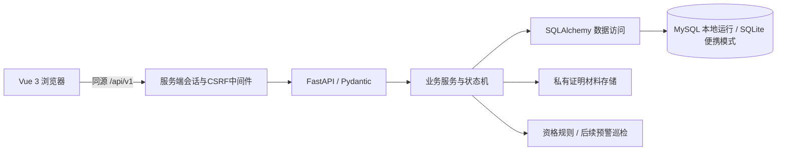
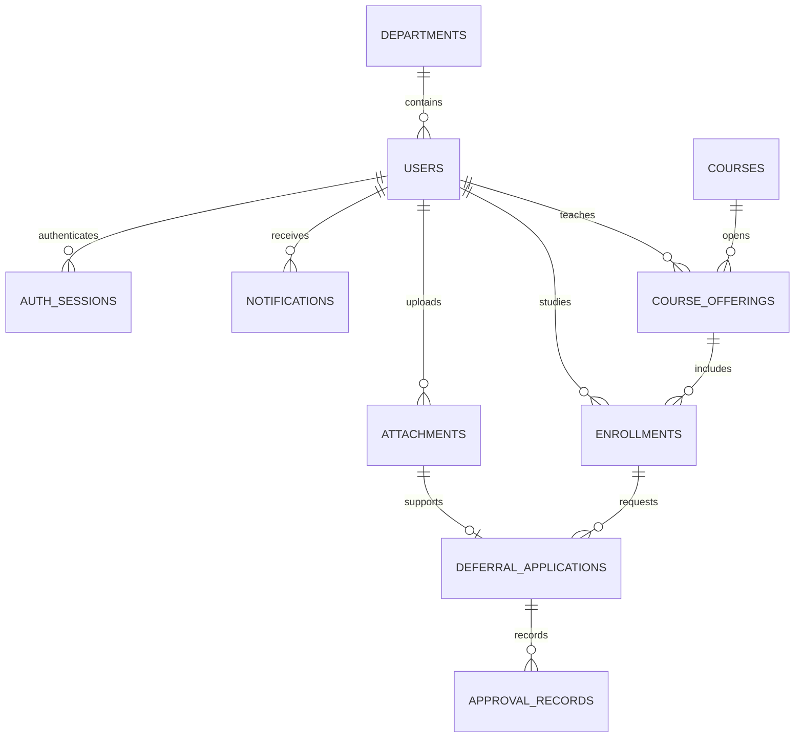

# 系统架构与数据库设计

## 1. 架构决策

采用前后端分离的模块化单体。Vue负责表单和状态展示；FastAPI接收HTTP，Pydantic校验与序列化，Service执行状态流转和事务，SQLAlchemy Core Repository执行参数化SQL。四个角色共享后端，数据范围由认证身份计算。规模适合单体，不引入微服务或消息队列。

Python 3.12+和FastAPI，依赖由uv.lock锁定。前端采用Composition API、`<script setup lang="ts">`。当前本地MySQL 8.0.36已接入，原有SQLite数据已逐列核对同步；保留SQLite作为便携模式。数据库由DATABASE_URL选择，两套测试分别在SQLite临时文件与独立MySQL测试库执行。Alembic负责版本迁移，禁止启动时自动删表。同步SQLAlchemy及BCrypt业务在线程池运行；ASGI安全中间件中的数据库读取也在线程池执行。

## 2. 第一阶段实体与关系

## 3. M1数据字典

业务主键在MySQL使用BIGINT，在SQLite使用INTEGER以支持自增；会话以SHA-256 token_hash为主键。时间按UTC保存为无时区日期，SQLAlchemy类型在读写时转换为带时区UTC，API输出ISO8601。字符串UTF-8，状态为受控枚举。种子与迁移分离，仅DEMO_MODE=true时允许初始化演示数据。

| 表 | 主要字段 | 约束及索引 |
| --- | --- | --- |
| departments | id, name | 主键，名称唯一 |
| users | id, username, password_hash, display_name, role, department_id | 用户名唯一，院系外键，BCrypt哈希，不提供公开注册 |
| courses | id, code, name, credits | 课程编号唯一 |
| course_offerings | id, course_id, teacher_id, term, exam_at | 课程/教师外键，保存开课学期 |
| enrollments | id, student_id, offering_id, score | 学生+开课唯一，score为空表示未出分，合法范围0–100 |
| attachments | id, owner_id, storage_name, original_name, media_type, size_bytes, created_at | 存储名唯一，owner外键，私有存储 |
| deferral_applications | id, enrollment_id, attachment_id, reason, status, created_at, updated_at | 选课/材料外键，材料唯一使用，选课和状态索引 |
| approval_records | id, application_id, reviewer_id, stage, decision, comment, created_at | 申请/审核人外键，申请+节点唯一 |
| notifications | id, recipient_id, title, content, application_id, is_read, created_at | 接收人+时间索引，申请外键可空 |
| auth_sessions | token_hash, user_id, csrf_token, expires_at | 只存会话标识哈希，匿名CSRF会话的user_id为空；有效期索引 |

完整字段类型和CHECK约束以`backend/migrations/versions/0001_initial.py`为准，运行期定义在`backend/app/models.py`。测试核对迁移后结构与运行期元数据一致。业务服务校验角色、课程归属和节点，不依赖前端传值。

## 4. 后续实体规划

retake_applications（重修资格及双层审核）、retake_classes（容量、教师、课程）、class_time_slots（周次、星期、起止节）、retake_enrollments（学生与班级唯一）、exam_arrangements（场地与时间）、grade_records及grade_history（成绩及修改历史）、rule_configs（版本化阈值）、validation_logs（规则ID、版本、输入摘要、结果、理由）、alerts（对象+规则+周期唯一）、audit_logs（操作人、动作、目标、时间）。后续实体尚未迁移，逐阶段新增Alembic revision，已应用迁移不得改写。

冲突判定：星期相同，周次区间有交集，节次区间有交集。以后若引入单双周，需改为实际周次集合交集。班级容量通过事务锁或条件更新保证，不能只先查询再插入。

## 5. 审核事务

读取当前申请及数据范围 → 验证当前角色与节点 → `UPDATE ... WHERE id=? AND status=?` → 检查更新行数为1 → 插入审核记录 → 通知申请人和下一节点审核人 → 提交。任一步失败全部回滚。拒绝意见必填；已终结申请不允许新增审核记录。教师审核归属基于开课教师，院系审核归属基于学生院系。

MySQL提交前用`SELECT ... FOR UPDATE`锁定选课行，再检查有效申请，使用READ COMMITTED隔离；材料也加行锁。审核先锁申请，再以原状态条件更新。SQLite不支持FOR UPDATE，写事务在任何读取前执行BEGIN IMMEDIATE，提前序列化写入并设置30秒等待。两种机制都不能以“先查后写”代替。材料必须本人上传、尚未绑定、文件存在；唯一约束阻止重复绑定。上传失败删除文件；孤立材料清理后续完成。

## 6. 安全和运维边界

同源会话避免把令牌放在localStorage；开发由Vite代理`/api`，生产由反向代理提供统一域名。写操作含CSRF头，上传也必须验证。服务端只接受PDF/PNG/JPEG且验证文件头；文件按UUID命名，原名仅用于安全下载响应，下载强制attachment及nosniff。

会话标识和CSRF分别使用加密随机数生成，数据库仅存会话标识哈希。登录使旧会话失效并轮换CSRF；退出删除记录。默认固定30分钟有效期，不因普通查询延长。会话存于数据库，因此应用重启后未过期会话可继续使用。上传在解析multipart前校验CSRF并限制请求总长6 MiB，再检查文件本身5 MiB；不声明恶意代码扫描能力。

M1限制文件5 MiB；不得将用户路径拼接到存储目录。学生读本人材料，教师读本人课程已提交申请的材料，院系读本院申请，校教务读已提交申请的材料。未绑定材料只对上传者可见。

本地MySQL的迁移、审核事务及双线程并发保护已实测。正式部署前仍需HTTPS、登录限流、密码修改与重置、完整备份恢复演练及压力测试。后续提醒模块可重试，基础业务成功不依赖辅助分析可用性。

## 7. 官方参考

- FastAPI数据库与依赖：https://fastapi.tiangolo.com/tutorial/sql-databases/ 、https://fastapi.tiangolo.com/tutorial/dependencies/
- Vue官方工程与TypeScript指南：https://vuejs.org/guide/quick-start.html 、https://vuejs.org/guide/typescript/overview
- SQLAlchemy SQLite事务：https://docs.sqlalchemy.org/en/20/dialects/sqlite.html
- SQLite事务：https://www.sqlite.org/lang_transaction.html
- Alembic：https://alembic.sqlalchemy.org/en/latest/tutorial.html

参考用于实现与环境核对；论文引用需按学校要求补全访问日期、版本和引文格式，不据此编造参考文献或调研数据。
