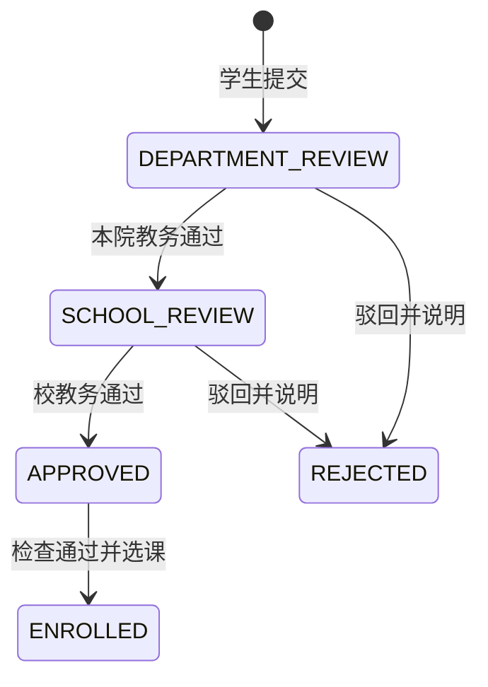
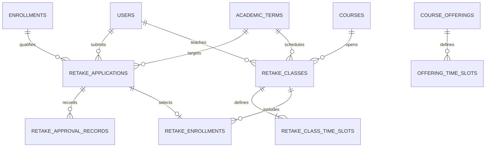

# M2重修申请、开班选课与冲突检测

应用版本0.3.0；状态：2026-11-28用户明确验收M2并授权提交推送。基线为M1提交ca55e79，M2分支codex/m2-retake-workflow。

## 1. 本阶段范围

学生可对已有不及格成绩的本人课程申请指定学期重修；院系与校教务依次审核，通过后学生选重修班。校教务维护班级、教师、教室、容量和时间段；教师查看本班名册；院系教务仅看到本院学生。学生课表合并未出分的在修课程和已选重修班。

本阶段实现到选课ENROLLED。不包含退选、换班、删除班级、缴费、成绩录入、学籍归档、真实教务导入或AI模型。班级开设后课程、学期、教师、教室、时间段固定，仅允许调整容量和开放/暂停选课。基础课程、教师、学期的通用维护属于M4。

## 2. 演示业务规则

- 资格：指定选课记录属于当前学生，score不为空且小于60；不允许冒用其他学生课程。不及格原成绩保留，不因申请或选课修改。
- 唯一性：同一学生、课程和目标学期仅一份有效申请；驳回后可新建，历史申请与意见保留。M2不处理“历史不及格但后来已通过”的复杂成绩认定，正式资格仍以学校制度为准。
- 审核：院系审核以学生所属院系为准，不含教师前置初审；校教务不能越过院系。驳回意见必填，最长500字。
- 选课：申请必须APPROVED、尚未选课；班级课程与学期必须匹配，状态OPEN、有空余、时间无冲突。请求中不接收学生ID或目标申请状态。
- 暂停选课不是取消教学：已有选课、名册和课表保留，仍参与冲突判断。容量不得小于已选人数，范围1–200。
- 名册：学生不能读名册；授课教师仅本班，校教务全校，院系教务仅本院学生。

## 3. 数据模型与迁移

新增迁移0002_retake_workflow，未改写0001。MySQL升级前备份为忽略目录.runtime/backups/m1-before-m2.sql，原1份缓考申请及3条审核记录保持不变。

| 表 | 关键字段与约束 |
| --- | --- |
| academic_terms | id、唯一name、week_count（1–30） |
| offering_time_slots | 原开课offering_id、起止周次、星期、起止节次、教室；提供在修课冲突依据 |
| retake_applications | student_id、enrollment_id、course_id、term_id、reason、status、is_active、创建/更新时间 |
| retake_approval_records | application_id、reviewer_id、stage、decision、comment、时间；申请+节点唯一 |
| retake_classes | name、course_id、term_id、teacher_id、capacity、room、status、created_by；同学期名称唯一 |
| retake_class_time_slots | class_id、起止周、星期、起止节；数据库及Pydantic双层范围校验 |
| retake_enrollments | application_id唯一、student_id+class_id唯一、时间 |
| notifications扩展 | 新增可空retake_application_id；原application_id继续表示缓考 |

有效申请采用(student_id,course_id,term_id,is_active)唯一约束；有效状态is_active=TRUE，驳回后NULL，利用两种数据库唯一约束对NULL的语义保留多份驳回历史，并用CHECK禁止状态和标识不一致。

## 4. 冲突口径与说明

只比较同一目标学期；原开课的term字符串与academic_terms.name精确对应。星期相同、周次区间相交、节次区间相交时构成冲突，边界均包含。例如1–2节与3–4节不冲突，与2–3节冲突；1–16周与17–20周不冲突，与16–20周冲突。

学生来源：本人未出分的在修课时间段，以及本人已选重修班时间段。已出分课程不作为在修课处理。开班时额外检查同学期教师或教室占用，也拒绝同一新班内部重叠时间段。

预检查返回allowed、reasons、conflicts、alternatives。每个冲突包含REGULAR/RETAKE来源、课程/班级、已有与申请时间段及文字说明。备选班必须同课程同学期、OPEN、有余量且不与该学生现有课表冲突。没有备选时返回空数组，不编造班级。

预检查不占位。最终确认在事务锁内重新检查全部条件，避免检查后被他人抢走最后名额。失败返回409及可读原因，不创建选课记录。

课表基于已提供的时间段数据；当前演示种子提供3门在修课程课表。尚未对接真实教务，不支持单双周、节假日调课、多校区路程或不规则日期，正式使用前须完善真实课表数据。持久化规则判断日志留待M4，本阶段返回当次判断依据。

## 5. 事务和锁顺序

MySQL使用READ COMMITTED：提交重修先锁学生行，再检查同课程学期唯一性；审核先确定归属，再按学生行→申请行加锁；选课按学生行→班级行→申请行加锁，读取最新名额与课表后插入、更新状态并通知。相同学生的不同班级同时选课被学生行锁串行化，防止两份冲突课同时通过；不同学生争抢名额被班级行锁串行化。

审核、选课记录、申请状态及通知在同一事务内，通知写入失败全部回滚。开班先锁目标学期行，序列化同学期教师/教室占用检查与插入；班级容量/状态更新锁班级行后核对已选人数。SQLite在任何业务读取前使用BEGIN IMMEDIATE序列化写入。唯一约束作为第二道保护。

## 6. API与权限

均以/api/v1为前缀，沿用Cookie、CSRF和camelCase；POST/PATCH需X-CSRF-TOKEN。列表page默认1、size默认20且上限100。

| 方法与路径 | 权限/输入 | 输出 |
| --- | --- | --- |
| GET /retake-meta | 登录；角色决定可见选项 | terms、eligibleCourses（学生本人失败课程）、courses/teachers（仅校教务） |
| GET /retakes | 按本人/院系/校级范围；教师仅已入本人班的申请 | Page；支持pendingOnly |
| POST /retakes | 学生；enrollmentId、termId、reason | 201，RetakeDetail |
| GET /retakes/{id} | 数据范围内 | application及approvals |
| POST /retakes/{id}/reviews | 院系/校教务当前节点；decision、comment | 更新后的详情 |
| GET /retake-classes | 登录；教师仅本人班；可按termId/courseId过滤 | Page，含已选人数及slots |
| POST /retake-classes | 校教务；name/courseId/termId/teacherId/capacity/room/slots | 201，班级 |
| PATCH /retake-classes/{id} | 校教务；status及capacity | 更新后的班级 |
| POST /retake-classes/{id}/conflict-check | 学生；applicationId | ConflictResult |
| POST /retake-enrollments | 学生；applicationId、classId | 201，申请变为ENROLLED |
| GET /retake-classes/{id}/students | 教师本人班/校教务；院系仅本院行 | 学生名册 |
| GET /timetable?termId=... | 学生本人 | 在修和已选重修时间段 |

TimeSlot示例：`{"startWeek":1,"endWeek":16,"weekday":6,"startPeriod":1,"endPeriod":2}`。最多8段，周次不得超出学期长度，节次1–12，星期1–7。

## 7. 本地验收步骤

入口http://127.0.0.1:5173/，密码Demo@2026。当前业务库没有浏览器联调生成的重修申请；联调使用独立测试库，用户可从提交开始完整体验。

1. 学生20240001登录，进入“重修服务”→“新建重修申请”。选程序设计基础（52分）及演示学期“2026—2027 学年 · 第一学期”，填写至少10字理由并提交，状态应为待院系审核。默认项是学期列表首项，不按日历推断当前学期。再次提交同课程学期被拒绝。
2. dept01登录，进入重修服务，勾选仅看待我审核，打开详情通过；状态待校教务。admin终审通过后变为可选重修班。教师不参与这两级审核。
3. 学生回到该申请点“选课”。默认演示班：周一1–2节（与数据结构冲突）、周六1–2节（无冲突）、周日3–4节（容量1）。选择周一班检查，应显示数据结构、周次/节次重叠依据及周六/周日备选，不允许确认。
4. 选周六备选，通过预检查后确认。申请变为已选课，班级人数增加；在“我的课表”选择与申请相同的演示学期，看到3门在修课与程序设计基础重修课。不能再次给同一申请选班。
5. teacher01登录重修服务，只见本人重修班；打开周六班名册，应有高同学。teacher02不能读该班名册；dept02仅能看到本院学生，不应看到该学生。
6. admin进入“开班管理”新建程序设计基础班，选择教师、教室、容量和时间段；教师或教室重叠应被阻止。可用陈老师、C301、周二7–8节1–16周验证成功开班。
7. admin暂停班级选课，已选名单和课表保留；重新开放后可继续选。UI容量控件下限为已选人数与1的较大值，检查其下限即可。后端缩容为合法正值但低于已选人数、未审批申请选课、课程/学期不匹配和最后名额竞争，由11文档对应API自动用例验证：这些状态不能直接通过受约束的下拉框输入，不要求普通用户手工绕过界面。
8. 通知跳转：院系点击重修待办通知进入该重修申请；学生点击终审/选课通知进入同一重修详情。关闭后再次点击同一通知仍可打开；再点击原缓考通知，应继续进入缓考详情。

驳回重提可在第一次审核时测试：不填意见驳回应被阻止，填写原因后驳回，学生可新建申请并保留旧轨迹。M2提供的是演示规则，正式申请窗口、学分上限等后续按学校制度调整。

## 8. 版本与证据

M1基线：[ca55e79](https://github.com/Mengsanfen/student-course-retake-management-system/commit/ca55e79fd45daeb69abc0a82cab3fbe7d5382548)。M2自动测试与浏览器证据见11文档；用户已明确验收并授权本次提交推送。
